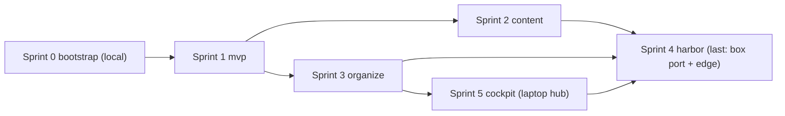

# Mini-sprint order

Read by the conductor (`CONDUCTOR.md`) to decide what to start, and by each mini-sprint orchestrator to learn its package. A mini-sprint is a set of phase-manager sessions that merge onto one joined branch (`sprint/<id>-<slug>`) and reach `main` through one PR the user approves. Sprints with no dependency on each other run in parallel, each in its own container.

Each package block below is machine-readable (YAML in a fence). `scripts/sprint/run-sprint.ps1 -Sprint <id>` (built in S0c) renders the level-1 prompt from `PROMPT-BOOK.md` section 3 plus the block, writes it to `.sprint/<id>/sprint-prompt.md`, and starts the container.

## 1. Dependency graph



| Sprint | Name | Sessions | Depends on (merged to main) | User gates before start | Can run beside | Max parallel phase managers |
|--------|------|----------|-----------------------------|-------------------------|----------------|------------------------------|
| 0 | bootstrap | S0, S0c, S0b | none | none; S0b needs your capture day in the middle | nothing (runs locally, not in a container) | 2 |
| 1 | mvp | S1, S2, S3, S4, S5, S6 | 0 | `docs/ENVIRONMENT.md` filled | nothing (everything downstream needs it) | 3 |
| 2 | content | S7, S8 | 1 | none | 3, 5 | 1 |
| 3 | organize | S9, S10, S9b | 1 | none | 2 | 2 |
| 4 | harbor | S11, S12 | 2, 3, 5 | macOS box ready (decision 15): always on, macOS Docker runtime installed (OrbStack suggested); box hostname + SSH confirmed; Supabase self-hosted vs cloud decided (or S11 recommends and blocks); Cloudflare zone available | nothing (last stage, ADR 0010) | 1 |
| 5 | cockpit | S13, S14, S15 | 3 | decide whether S15 (Electron) is wanted | 2 | 2 |

## 2. Rules the conductor applies

- Start a sprint only when every `depends_on` sprint is merged to `main` and every user gate is answered.
- Concurrency cap: 2 sprint containers at once by default (each may run up to its max parallel phase managers; every headless session counts against your 5h and 7d windows). Raise or lower the cap in `CONDUCTOR.md` settings when `/usage` headroom says so.
- Preference when more than two are startable: 2 (content) before 3 (organize) before 5 (cockpit); 2, 3 and 5 all touch `packages/web`, so the earlier one to merge sets the base the others rebase on; 4 (harbor) is always last (ADR 0010): the UI and functionality work locally against the laptop hub first, then the stack ports to the box.
- Soak periods in a phase's Definition of Done (probe two days on the laptop, board three days of use) do not block merge approval. The PR is approved on evidence; soak findings become fix sessions in the next sprint. The conductor tracks soaks as "waiting on you" items.
- Laptop-only verification (Windows probe bench, real settings.json install, opening the board from the phone through Access) is done by the conductor session on the laptop with you present, never from a container.
- Secrets never enter containers except the two tokens the container needs (Claude auth, GitHub push). No SSH keys, no Cloudflare tokens, no Supabase service keys. Sprint 4 therefore produces runbooks and compose files; the box-side execution happens from the conductor session.

## 3. Packages

Sprint ids are kept (they name branches and state dirs) and blocks are listed in id order; the run order is in section 1: Sprint 4 harbor runs last (ADR 0010).

### Sprint 0: bootstrap (local)

Runs on the laptop, not in a container, because its output includes the container tooling. The conductor runs the three sessions as local `claude` processes (or you run them in separate terminals with the level-2 prompt), S0 first, then S0c and S0b in parallel after your capture day.

```yaml
sprint: "0"
name: bootstrap
slug: bootstrap
branch: sprint/0-bootstrap
depends_on: []
user_gates: []
max_parallel: 2
runs_in: local
sessions:
  - id: S0
    handoff: S00-contract-and-scaffold.md
    branch: p0/scaffold
    phase: 0
    depends_on: []
    security_gated: true          # fixtures directory, settings merge of the capture hook
  - id: S0c
    handoff: S00c-sprint-tooling.md
    branch: p0/sprint-tooling
    phase: 0
    depends_on: [S0]
    security_gated: true          # tokens in containers, docker socket
  - id: S0b
    handoff: S00b-fixtures-and-reducer-finalization.md
    branch: p0/fixtures
    phase: 0
    depends_on: [S0]
    user_gate: "capture hook installed and one working day of sessions run (S0 tells you how)"
    security_gated: true
merge_order: [S0, S0c, S0b]
integration_checks:
  - "pnpm -r test on ubuntu and windows CI"
  - "scripts/sprint/run-sprint.ps1 -Sprint smoke starts a container that runs a one-line headless claude session and writes .sprint/smoke/status.json state=green"
  - "packages/contract fixture suite: at least 50 fixtures, 12 events, 20 statusLine samples, security gate pass"
needs_laptop:
  - "verify guard.mjs fires via ${CLAUDE_PROJECT_DIR} in exec form (docs/PERMISSIONS.md)"
  - "claude setup-token works for the container auth (S0c records the exact command in infra/sprint/README.md)"
```

### Sprint 1: mvp

```yaml
sprint: "1"
name: mvp
slug: mvp
branch: sprint/1-mvp
depends_on: ["0"]
user_gates:
  - "docs/ENVIRONMENT.md filled (Claude Code version, plan type, Git Bash, WSL2, Node)"
max_parallel: 3
runs_in: container
sessions:
  - { id: S1, handoff: S01-probe-hook-and-statusline.md, branch: p1/probe-hook,  phase: 1, depends_on: [],        security_gated: true,  lane: A }
  - { id: S2, handoff: S02-probe-daemon.md,              branch: p1/probe-daemon, phase: 1, depends_on: [],       security_gated: false, lane: A }
  - { id: S3, handoff: S03-hub-core.md,                  branch: p2/hub-core,     phase: 2, depends_on: [],       security_gated: true,  lane: B }
  - { id: S4, handoff: S04-hub-history-replay-compose.md, branch: p2/hub-history, phase: 2, depends_on: [S3],     security_gated: false, lane: B }
  - { id: S5, handoff: S05-board-on-mocks.md,            branch: p3/board-mock,   phase: 3, depends_on: [],       security_gated: false, lane: C }
  - { id: S6, handoff: S06-board-live.md,                branch: p3/board-live,   phase: 3, depends_on: [S3, S5], security_gated: false, lane: C }
merge_order: [S3, S4, S1, S2, S5, S6]
integration_checks:
  - "docker compose -f infra/docker-compose.yml up -d; GET /health 200; ingest a replayed day of fixture spool; GET /sessions?live=1 returns the reconstructed sessions"
  - "probe daemon (Linux build) loss harness against the containerized hub: 500 sent, 500 accepted, 0 duplicates, hub killed and restarted mid-run"
  - "web Playwright flows from S5 and S6 against the live hub: board shows the replayed sessions, attention sort, drawer, compact mode, both themes; screenshots saved"
  - "hub load harness at 1k envelopes/s: p95 under 20 ms per batch of 100"
needs_laptop:
  - "R1.1 hook p95 < 80 ms on Windows (scripts/bench-hook.mjs on the laptop)"
  - "probe install for real; two-day soak alongside agentic-harness (does not block merge)"
  - "board used for three days; docs/BOARD-FEEDBACK.md (does not block merge)"
notes: "S1 and S2 are both probe; S2 builds against the spool schema in packages/contract if S1 has not merged yet. Lane C starts on mocks and flips to live when S3 is green."
```

### Sprint 2: content

```yaml
sprint: "2"
name: content
slug: content
branch: sprint/2-content
depends_on: ["1"]
user_gates: []
max_parallel: 1
runs_in: container
sessions:
  - { id: S7, handoff: S07-normalizer-and-redaction.md, branch: p4/normalize,    phase: 4, depends_on: [],   security_gated: true,  lane: A }
  - { id: S8, handoff: S08-content-view.md,             branch: p4/content-view, phase: 4, depends_on: [S7], security_gated: false, lane: A }
merge_order: [S7, S8]
integration_checks:
  - "normalizer golden tests on all fixture transcripts; unknown-row fallback renders"
  - "redaction corpora: 0 leaks on the secret corpus, < 2% false positives on the benign corpus"
  - "Playwright: open a 5 MB fixture transcript in the content view, initial render < 500 ms, scroll to a diff, open a subagent thread; screenshots saved"
  - "transcript tail end-to-end: append lines to a fixture transcript while the daemon (Linux build) runs; lines appear in the view within 2 s"
needs_laptop:
  - "redaction rules reviewed by you once against a real transcript of yours before the next sprint ships transcripts off the laptop"
notes: "S7 needs five full transcript fixtures (one with subagents, one with a compaction); if packages/contract/fixtures/transcripts/ is empty, S7 blocks with a question listing what to capture."
```

### Sprint 3: organize

```yaml
sprint: "3"
name: organize
slug: organize
branch: sprint/3-organize
depends_on: ["1"]
user_gates: []
max_parallel: 2
runs_in: container
sessions:
  - { id: S9,  handoff: S09-s9b-atlas.md, branch: p5/atlas-core,     phase: 5, depends_on: [],   security_gated: false, lane: A, goal: "S9 part only" }
  - { id: S10, handoff: S10-layouts.md,   branch: p6/layouts,        phase: 6, depends_on: [],   security_gated: false, lane: B }
  - { id: S9b, handoff: S09-s9b-atlas.md, branch: p5/archive-import, phase: 5, depends_on: [S9], security_gated: false, lane: A, goal: "S9b part only" }
merge_order: [S9, S10, S9b]
integration_checks:
  - "archive importer: 20 fixture vault files import idempotently in under 10 s; live record merges with its archive by session_id"
  - "search: < 100 ms on the fixture data; palette keyboard-only flow (Playwright)"
  - "layouts: seven presets screenshot at 1440x900 and 2560x1440; auto-fit table test; Shift+C restore exact"
  - "six content panes at 20 deltas/s: Playwright trace shows no dropped frames"
needs_laptop:
  - "importer pointed at the real vault path on each machine (probe.json per host)"
notes: "S9 and S10 both edit packages/web; S10 merges after S9 and rebases. If Sprint 2 merged first, both rebase on main at launch (setup step 1 handles it)."
```

### Sprint 4: harbor

```yaml
sprint: "4"
name: harbor
slug: harbor
branch: sprint/4-harbor
depends_on: ["2", "3", "5"]
user_gates:
  - "box exists; it is the always-on M2 Pro laptop on macOS (decision 15) with a macOS Docker runtime (OrbStack suggested); hostname and SSH key confirmed to the conductor (keys stay on the laptop)"
  - "Supabase: self-hosted on the box or cloud project (S11 may recommend, then block for approval)"
  - "Cloudflare zone and Access identity provider available"
max_parallel: 1
runs_in: container
sessions:
  - { id: S11, handoff: S11-s12-harbor.md, branch: p7/box,  phase: 7, depends_on: [],    security_gated: true, lane: A, goal: "S11 part only" }
  - { id: S12, handoff: S11-s12-harbor.md, branch: p7/edge, phase: 7, depends_on: [S11], security_gated: true, lane: A, goal: "S12 part only" }
merge_order: [S11, S12]
integration_checks:
  - "Supabase Postgres (container) migration applies; SQLite fixture history imports with matching row counts; hub smoke test passes against it"
  - "cloudflared config validates (cloudflared tunnel ingress validate) with placeholder credentials"
  - "restore drill script restores a pg_dump into a scratch container and passes the hub smoke test"
  - "trivy and npm audit in CI with no critical findings"
  - "port to the macOS box with linux/arm64 images; every image multi-arch or arm64"
  - "S13 runner security re-review with the hub reachable through Access before harbor merges"
needs_laptop:
  - "everything that touches the box: provisioning, compose up on the box, tunnel creation, Access policies, nmap from the laptop, phone test through Access (conductor session, you present)"
  - "docs/HARDENING.md evidence lines are filled from the box, not the container"
  - "runner on the Windows laptop connected to the box hub through Access (for the S13 re-review evidence)"
notes: "The container has no SSH key and no Cloudflare or Supabase secrets. S11 and S12 produce runbooks, compose files, and scripts, tested locally in containers; the conductor executes the box steps with you. Harbor is the last sprint (ADR 0010); it starts only after Sprints 2, 3 and 5 are merged and working against the laptop hub."
```

### Sprint 5: cockpit

```yaml
sprint: "5"
name: cockpit
slug: cockpit
branch: sprint/5-cockpit
depends_on: ["3"]
user_gates:
  - "decide whether S15 (Electron shell) is wanted after using the browser version"
max_parallel: 2
runs_in: container
sessions:
  - { id: S13, handoff: S13-s14-s15-cockpit.md, branch: p8/runner,     phase: 8, depends_on: [],    security_gated: true,  lane: A, goal: "S13 part only" }
  - { id: S14, handoff: S13-s14-s15-cockpit.md, branch: p8/cockpit-ui, phase: 8, depends_on: [],    security_gated: false, lane: B, goal: "S14 part, UI on mocks first; live wiring after S13 green" }
  - { id: S15, handoff: S13-s14-s15-cockpit.md, branch: p8/electron,   phase: 8, depends_on: [S14], security_gated: false, lane: B, goal: "S15 part only", optional: true }
merge_order: [S13, S14, S15]
integration_checks:
  - "runner (Linux build) launch harness: 10 SDK sessions and 3 pty sessions start and stop in sequence against the laptop hub (the containerized hub from infra/docker-compose.yml on the laptop; harbor has not run yet); each appears on the board; launches logged as events"
  - "runner refuses unauthenticated and out-of-allow-list launch requests (security test suite)"
  - "Playwright: launcher flow from project pick to card on board; terminal pane echo round trip, against the laptop hub (the containerized hub from infra/docker-compose.yml on the laptop; harbor has not run yet)"
needs_laptop:
  - "runner on Windows: ConPTY pty launch, open-in-Windows-Terminal, registration at login (conductor session, you present)"
  - "R8.3 terminal latency measured against the laptop hub (re-measured through the box in Sprint 4)"
notes: "S13 is the one session whose security gate the conductor must re-confirm with you before merge approval, because the runner executes processes on your laptop. Cockpit runs before harbor (ADR 0010): the hub is on the laptop, bound to localhost; S13's security gate is re-run in Sprint 4 once the hub is reachable through Access."
```

## 4. After the last sprint

Sprint 4 (harbor, the last sprint) merged means every phase doc's Definition of Done is either evidenced or listed under "needs laptop confirmation" with a date you did it. The conductor's final job is to produce `docs/RELEASE-1.md`: what shipped per phase, what was deferred (with the deferred findings from every session log), and the soak results.
