# Contract: envelope and session state machine

Package: `packages/contract` (`@sessiondeck/contract`). Pure TypeScript and zod, no I/O. Claude Code version at scaffold time: 2.1.295. Regions between `BEGIN:` and `END:` markers are generated: run `pnpm -F @sessiondeck/contract gen:doc` (add `-- --check` to only verify). A test fails if they drift.

## Envelope

Every probe-to-hub message is one `Envelope` (`src/envelope.ts`, architecture 3.1).

| Field | Type | Rule |
| --- | --- | --- |
| `v` | `1` | envelope schema version |
| `id` | string | ULID, assigned by the probe at write time |
| `kind` | `hook` `statusline` `subagents` `transcript` `liveness` `probe` | event kind |
| `host` | string | machine name, non-empty |
| `os` | `win32` `linux` `darwin` | host OS |
| `session_id` | string or null | null only for kind `probe` |
| `agent_id` | string, optional | present when the hook ran inside a subagent |
| `hook_event_name` | string, optional | required for kind `hook` |
| `ts` | integer >= 0 | epoch ms at the probe |
| `seq` | integer >= 0 | per-host sequence; the hub orders by `(host, seq)` |
| `payload` | unknown | the raw stdin JSON, never reshaped; the key must be present |

## Liveness payload and the pid (decided in S0, confirm in S1)

The `Envelope` interface has no `pid` field. The pid travels in the payload of `liveness` envelopes, which are our own payload, not Claude Code's: `LivenessPayloadSchema = { pid: positive integer, alive: boolean }`, with the envelope's `session_id` naming the session.

- `alive: true` is the pid report: `reduceLiveness` sets `snapshot.pid`.
- `alive: false` on a session that is not `ended` or `exited` moves it to `exited`, unless its pid differs from `snapshot.pid`.
- Who emits the first report (hook at SessionStart, or the daemon) is Phase 1's choice.
- A new `session_id` under the same host and pid (`/clear`, `--resume`) ends the previous session: `supersedeSamePid(sessions, { host, session_id, pid, ts })` returns the collection with those sessions `ended`, `ended_reason: 'superseded'`.

## State machine

Three pure functions share one frozen table (`TRANSITIONS` in `src/transitions.ts`): `reduce(prev, hookEnvelope)`, `reduceLiveness(prev, livenessEnvelope)`, `supersedeSamePid(...)`. The diagram and the table below are generated from it.

Decisions:

- `reduce` is total and deterministic. Unknown events and malformed payloads only update `last_event_at`. Time comes only from `e.ts`. Inputs are never mutated.
- Routing precondition: an envelope whose `session_id` or `host` differs from the snapshot's makes `reduce` and `reduceLiveness` return `prev` itself, unchanged. The hub routes by `(host, session_id)`.
- `state_since` changes only when `state` changes. `state_detail` is display text only and no logic reads it. Text copied from payloads is capped, with a visible `...[truncated]` marker: `last_prompt` and `last_assistant_message` 2000 chars, `state_detail` and tool names 120.
- `tracking` (added in S0 beyond architecture 3.3, reducer bookkeeping, confirm before S3 and S5): `last_tool` is the last tool of a main-thread `PreToolUse` (cleared by `UserPromptSubmit` and `Stop`; the `Stop` guards read it). `permission` is who holds the open prompt (`tool`, and `agent_id`, null for the main thread); null unless `waiting_permission`.
- Tool events (`PreToolUse`, `PostToolUse`, `PostToolUseFailure`, `PermissionDenied`) leave `waiting_permission` only from the context that asked. From any other context they change only `last_event_at`. `UserPromptSubmit`, main-thread `Stop`, `StopFailure`, `SessionEnd` and a non-compact `SessionStart` leave it from any context. Open: parallel tool calls inside the requesting context (skipped `TODO(fixture)` test).
- `ended` accepts only `SessionStart` (resume) with a source other than `compact`; everything else just updates `last_event_at`, so the first `ended_reason` is kept. `ended_superseded` is the row state of an `ended` session with `ended_reason: superseded`: like `exited`, any later hook for it revives it (ccmonitor sees events continue under the old id after `--continue`).
- `exited` means the pid vanished without `SessionEnd`. A later hook proves the process is alive, so any event with a row from `exited` is applied normally. `alive: false` for a pid other than `snapshot.pid` is ignored.
- `SessionStart` with a source other than `compact` moves any state to `starting` and resets `tracking`; source `compact` changes no state.
- `PostCompact` moves `starting`, `working` (and revives `exited`, `ended_superseded`) to `working`; from every other state it only counts `compactions`. This narrows architecture line 99, which lists it under `working`: a manual `/compact` at an idle prompt must not show `working`.
- A hook with `agent_id` (inside a subagent) never moves the session to `idle`, `waiting_input` or `ended`, and writes neither `last_tool` nor `state_detail`. It may reach `waiting_permission`. A subagent's `StopFailure` still gives `error` (unconfirmed). `SubagentStart` and `SubagentStop` maintain `subagents` rows and never change `state`.
- A `Notification` of type `permission_prompt` or `elicitation_dialog` is the late fallback for `PermissionRequest`; it does nothing when already `waiting_permission`, and leaves `waiting_input` alone.
- Fields are read defensively. A wrong-typed `notification_type`, `reason` (`unknown` if absent), `last_assistant_message`, `prompt`, `model`, `agent_id`, `agent_type` leaves the snapshot field as it was. A missing or wrong-typed `tool_name` gives `tool:unknown` (and `last_tool` null), `error` gives `error`, `source` clears the detail.
- In the table, `any state except ended` includes `ended_superseded` (an ended session with reason superseded); a normal `ended` is excluded.

```mermaid
stateDiagram-v2
    [*] --> starting
    state "any state" as any_state
    state "any state except ended" as any_except_ended
    any_state --> starting : SessionStart if source is not compact
    any_except_ended --> working : UserPromptSubmit
    any_except_ended --> working : PreToolUse if no other context holds the permission prompt and not inside a subagent
    any_except_ended --> working : PreToolUse if no other context holds the permission prompt and inside a subagent
    any_except_ended --> working : PostToolUse if no other context holds the permission prompt
    waiting_permission --> working : PostToolUseFailure if no other context holds the permission prompt
    any_except_ended --> waiting_permission : PermissionRequest
    any_except_ended --> working : PermissionDenied if no other context holds the permission prompt
    starting --> waiting_permission : Notification if permission_prompt or elicitation_dialog
    working --> waiting_permission : Notification if permission_prompt or elicitation_dialog
    idle --> waiting_permission : Notification if permission_prompt or elicitation_dialog
    error --> waiting_permission : Notification if permission_prompt or elicitation_dialog
    exited --> waiting_permission : Notification if permission_prompt or elicitation_dialog
    ended_superseded --> waiting_permission : Notification if permission_prompt or elicitation_dialog
    any_except_ended --> waiting_input : Stop if not inside a subagent and last tool AskUserQuestion
    any_except_ended --> waiting_input : Stop if not inside a subagent and last tool ExitPlanMode
    any_except_ended --> idle : Stop if not inside a subagent
    any_except_ended --> error : StopFailure
    starting --> working : PostCompact
    working --> working : PostCompact
    exited --> working : PostCompact
    ended_superseded --> working : PostCompact
    any_except_ended --> ended : SessionEnd if not inside a subagent
    starting --> exited : liveness alive false
    working --> exited : liveness alive false
    waiting_permission --> exited : liveness alive false
    waiting_input --> exited : liveness alive false
    idle --> exited : liveness alive false
    error --> exited : liveness alive false
    starting --> ended : same pid, new session_id
    working --> ended : same pid, new session_id
    waiting_permission --> ended : same pid, new session_id
    waiting_input --> ended : same pid, new session_id
    idle --> ended : same pid, new session_id
    error --> ended : same pid, new session_id
```

<!-- BEGIN:state-diagram -->

<!-- END:state-diagram -->

<!-- BEGIN:transition-table -->
| Trigger | From | Condition | To | state_detail |
| --- | --- | --- | --- | --- |
| SessionStart | any state | source is not compact | starting | `source:<source>` |
| UserPromptSubmit | any state except ended | - | working | null |
| PreToolUse | any state except ended | no other context holds the permission prompt and not inside a subagent | working | `tool:<tool_name>` |
| PreToolUse | any state except ended | no other context holds the permission prompt and inside a subagent | working | unchanged if working, else null |
| PostToolUse | any state except ended | no other context holds the permission prompt | working | unchanged |
| PostToolUseFailure | waiting_permission | no other context holds the permission prompt | working | unchanged |
| PermissionRequest | any state except ended | - | waiting_permission | `tool:<tool_name>` |
| PermissionDenied | any state except ended | no other context holds the permission prompt | working | null |
| Notification | starting, working, idle, error, exited, ended_superseded | permission_prompt or elicitation_dialog | waiting_permission | unchanged |
| Stop | any state except ended | not inside a subagent and last tool AskUserQuestion | waiting_input | needs input |
| Stop | any state except ended | not inside a subagent and last tool ExitPlanMode | waiting_input | awaiting plan |
| Stop | any state except ended | not inside a subagent | idle | null |
| StopFailure | any state except ended | - | error | `<error>` |
| PostCompact | starting, working, exited, ended_superseded | - | working | null |
| SessionEnd | any state except ended | not inside a subagent | ended | null |
| liveness alive false | starting, working, waiting_permission, waiting_input, idle, error | - | exited | process gone |
| same pid, new session_id | starting, working, waiting_permission, waiting_input, idle, error | - | ended | superseded |
<!-- END:transition-table -->

A (state, trigger) pair with no row keeps `state`, `state_since` and `state_detail`.

## Provisional pending fixtures

The payload fields of these events are unverified (phase 0 blockers). Their transitions are not finalized; the reducer does the conservative thing below. Each has a skipped `TODO(fixture)` test in `packages/contract/test/state.test.ts`, as does the golden timeline from a real session (S0b).

<!-- BEGIN:provisional -->
| Event | Behavior now | Intended after fixtures |
| --- | --- | --- |
| PostToolUse | state working, tool_response not read | read tool_response to detect an interrupted or failed result |
| PostToolUseFailure | only leaves waiting_permission (to working); otherwise unchanged | payload marks an API error: error; a plain tool failure: working |
| StopFailure | any context, including a subagent, gives error | confirm whether a subagent's StopFailure should move the session |
| TaskCreated | state unchanged | tasks.total + 1 and tasks.last_subject from the payload subject |
| TaskCompleted | state unchanged | tasks.completed + 1 and tasks.last_subject from the payload subject |
| PreCompact | state unchanged | read the compaction trigger (manual or auto) into state_detail |
<!-- END:provisional -->

## Fixtures

- `packages/contract/fixtures/raw/<Event>/`: raw captures. Gitignored. Never loaded by tests.
- `packages/contract/fixtures/<Event>/*.json`: scrubbed, committed. `<Event>` is the hook event name, plus `statusLine/` and `subagentStatusLine/`.
- `packages/contract/fixtures/settings/`: settings-merge test input, not payloads.

## Units

`Window.resets_at` and `prompt_cache.expires_at` are epoch milliseconds in the snapshot and epoch seconds in the statusLine payload. Convert with `epochSecondsToMs` (`src/statusline.ts`).

## Observed payloads

(Empty. S0b fills this in from the scrubbed fixtures.)
