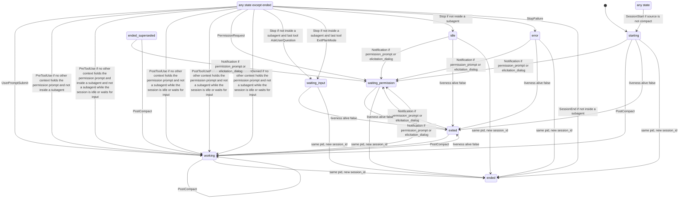

# Contract: envelope and session state machine

Package: `packages/contract` (`@sessiondeck/contract`). Pure TypeScript and zod, no I/O. Claude Code version at scaffold time: 2.1.295. Regions between `BEGIN:` and `END:` markers are generated: run `pnpm -F @sessiondeck/contract gen:doc` (add `-- --check` to only verify). A test fails if they drift.

## Envelope

Every probe-to-hub message is one `Envelope` (`src/envelope.ts`, architecture 3.1).

| Field | Type | Rule |
| --- | --- | --- |
| `v` | `1` | envelope schema version |
| `id` | string | ULID, assigned by the probe at write time |
| `kind` | `hook` `statusline` `subagents` `transcript` `liveness` `probe` | event kind |
| `host` | string | machine name, non-empty |
| `os` | `win32` `linux` `darwin` | host OS |
| `session_id` | string or null | null only for kind `probe` |
| `agent_id` | string, optional | present when the hook ran inside a subagent. The probe copies the payload's `agent_id` here on every hook; requester scoping depends on it (confirm in S1) |
| `hook_event_name` | string, optional | required for kind `hook` |
| `ts` | integer >= 0 | epoch ms at the probe |
| `seq` | integer >= 0 | per-host sequence; the hub orders by `(host, seq)` |
| `payload` | unknown | the raw stdin JSON, never reshaped; the key must be present |

## Liveness payload and the pid (decided in S0, confirm in S1)

The `Envelope` interface has no `pid` field. The pid travels in the payload of `liveness` envelopes, which are our own payload, not Claude Code's: `LivenessPayloadSchema = { pid: positive integer, alive: boolean }`, with the envelope's `session_id` naming the session.

- `alive: true` is the pid report: `reduceLiveness` sets `snapshot.pid`.
- `alive: false` on a session that is not `ended` or `exited` moves it to `exited`, unless its pid differs from `snapshot.pid`.
- Who emits the first report (hook at SessionStart, or the daemon) is Phase 1's choice.
- A new `session_id` under the same host and pid (`/clear`, `--resume`) ends the previous session: `supersedeSamePid(sessions, { host, session_id, pid, ts })` returns the collection with those sessions `ended`, `ended_reason: 'superseded'`.

## State machine

Three pure functions share one frozen table (`TRANSITIONS` in `src/transitions.ts`): `reduce(prev, hookEnvelope)`, `reduceLiveness(prev, livenessEnvelope)`, `supersedeSamePid(...)`. The diagram and the table below are generated from it.

Decisions:

- `reduce`, `reduceLiveness` and `supersedeSamePid` are total and deterministic and never throw. Unknown events only update `last_event_at`. A malformed payload is read as an empty one, so its row still fires with default text (`PreToolUse` with payload `null` moves `idle` to `working` with `tool:unknown`). Time comes only from `e.ts`. Inputs are never mutated.
- The hub stores `tracking` with the snapshot. A snapshot without a well-formed `tracking` is treated as having empty tracking, and the result carries a well-formed one.
- The probe copies the payload `agent_id` to `envelope.agent_id` on every hook (confirm in S1); the reducer reads only the envelope.
- Routing precondition: an envelope whose `session_id` or `host` differs from the snapshot's makes `reduce` and `reduceLiveness` return `prev` itself, unchanged. The hub routes by `(host, session_id)`.
- `state_since` changes only when `state` changes. `state_detail` is display text only and no logic reads it. Text copied from payloads is capped, with a visible `...[truncated]` marker: `last_prompt` and `last_assistant_message` 2000 chars; `state_detail`, tool names, `ended_reason`, model id, `agent_type` and `agent_id` 120; `tasks.last_subject` 200. `subagents` keeps 50 rows: past that the oldest ended rows go first, and a running row only when all are running.
- `tracking` (added in S0 beyond architecture 3.3, reducer bookkeeping, confirm before S3 and S5): `last_tool` is the last tool of a main-thread `PreToolUse` (cleared by `UserPromptSubmit` and `Stop`; the `Stop` guards read it). `permission` is the open prompt, `{ tool, agent_id }` (`agent_id` null for the main thread) or `{ tool: null, requester_unknown: true }`; null unless `waiting_permission`.
- Tool events (`PreToolUse`, `PostToolUse`, `PostToolUseFailure`, `PermissionDenied`) leave `waiting_permission` only from the context that asked; from any other context they change only `last_event_at`. When the requester is unknown (see the `Notification` rule) any context's tool event leaves. `UserPromptSubmit`, main-thread `Stop`, any `StopFailure`, main-thread `SessionEnd` and a non-compact `SessionStart` leave it from any context. Open: parallel tool calls inside the requesting context (see the open cases under Observed payloads).
- A subagent's tool event (`PreToolUse`, `PostToolUse`, `PostToolUseFailure`, `PermissionDenied` with `agent_id`) never leaves `idle` or `waiting_input` (in both the main turn is over and it is the user's move; a background subagent must not hide that signal or reopen the turn, and nothing would return the session to `idle` when it finished); a main-thread tool event or `UserPromptSubmit` does. Background work stays visible through `subagents` rows. `PostToolUse` and the `Notification` fallback keep `state_detail` only when the previous state is `working` or `waiting_permission`, else it becomes null.
- `ended` accepts only `SessionStart` (resume) with a source other than `compact`; everything else just updates `last_event_at`, so the first `ended_reason` is kept. `ended_superseded` is the row state of an `ended` session with `ended_reason: superseded`: like `exited`, any later hook that has a row from it revives it (ccmonitor sees events continue under the old id after `--continue`). `TaskCreated`, `SubagentStart` and a subagent `Stop` have no row, so they do not revive it.
- `exited` means the pid vanished without `SessionEnd`. A later hook proves the process is alive, so any event with a row from `exited` is applied normally. `alive: false` for a pid other than `snapshot.pid` is ignored.
- `SessionStart` with a source other than `compact` moves any state to `starting` and resets `tracking`; source `compact` changes no state.
- `PostCompact` moves `starting`, `working` (and revives `exited`, `ended_superseded`) to `working`; from every other state it only counts `compactions`. This narrows architecture line 99, which lists it under `working`: a manual `/compact` at an idle prompt must not show `working`.
- A hook with `agent_id` (inside a subagent) never moves the session to `idle`, `waiting_input` or `ended`, never leaves `idle` or `waiting_input` (tool events), and never writes `last_tool`; its `PreToolUse` and `PostToolUse` write no tool into `state_detail`. It may reach `waiting_permission`, and its `PermissionRequest` and `StopFailure` do write `state_detail`. A subagent's `StopFailure` still gives `error` (unconfirmed). `SubagentStart` and `SubagentStop` maintain `subagents` rows and never change `state`.
- Subagent parent links (R3.11), option B: each `subagents` row has `parent_agent_id` (the spawning agent's id; null for the main thread, and also null when unknown) and `parent_known` (false when the parent is not known). Every row created by the reducer from hook envelopes (`SubagentStart`) is unlinked: `parent_agent_id` null, `parent_known` false, shown at the session's first level. Reason: hook envelopes do not carry the spawning context reliably, and FIFO matching of `PreToolUse` (`Agent`/`Task`) to `SubagentStart` produced wrong known parents under failure-after-start, cap drops, and prompt resets (a window rule only narrowed this). Unlinked is always safe; a wrong known parent is not. Exact links come from S7 transcript subagent attachment, so nested links arrive with S7; until then no hook-built row is nested. The reducer keeps no spawn bookkeeping: `tracking` is `last_tool` and `permission` only. `readTracking` ignores `pending_spawns`, `pending_tainted`, and `ambiguous_remaining` in old stored snapshots and never throws on them. The row fields stay in the schema so S7 can write real links. Stored rows keep their links: `readSubagentRow` defaults rows stored before these fields existed to null / false, caps `agent_id` and `parent_agent_id` at 120 characters, and reads `parent_known: true` with a `parent_agent_id` that is neither a string nor null as false. `readSubagentRows(raw)` reads a stored list: `[]` for a non-array, drops non-object elements and rows without a string `agent_id`, caps each `agent_id` and then drops rows repeating one (first kept), keeps only the last 50 (`SUBAGENT_ROWS_MAX`) before normalizing, and normalizes links (a parent not in the list, or on a cycle including a self link, reads null / unknown). The reducer applies the same normalization after the 50-row cap (oldest ended rows go first), so a child of a dropped row reads unlinked. Fixtures: the captured `PreToolUse` for `Agent` carries no `agent_id` (main thread) and subagent tool hooks carry `agent_id`; no capture shows a subagent spawning a subagent.
- `PostToolUseFailure` is a tool event like `PostToolUse` (same row guards and detail rule): it moves any live state to `working`. The captured payload is `{error, is_interrupt, duration_ms}` plus the tool fields; nothing in it marks an API error (that is `StopFailure`), so it never gives `error`. Before U3 it only left `waiting_permission`. `is_interrupt` is not read (it was `false` in all 6 committed fixtures).
- `PostToolUse` does not read `tool_response` (objects and arrays in the committed fixtures, strings in the full capture; no `interrupted: true` was committed).
- `TaskCreated` and `TaskCompleted` change no state. They add to `tasks`: `total + 1`, respectively `completed + 1` with `total` raised to at least `completed`, and `last_subject` from `task_subject` (kept when absent). Synthetic fixtures only, so the field names follow the hooks reference. `PreCompact` writes `compact:<trigger>` into `state_detail` while the state is `working` (`PostCompact` clears it); from any other state it changes nothing but `last_event_at`.
- A `Notification` of type `permission_prompt` or `elicitation_dialog` is the late fallback for `PermissionRequest`; it does nothing when already `waiting_permission`, and leaves `waiting_input` alone. With an `agent_id` it records that agent as the requester. Without one the requester is unknown (provisional: the hooks doc says sandboxed network prompts fire only this Notification and that `agent_id` appears only inside a subagent), so any context's tool event leaves `waiting_permission`.
- Fields are read defensively. A wrong-typed `notification_type`, `reason` (`unknown` if absent), `last_assistant_message`, `prompt`, `model`, `agent_id`, `agent_type` leaves the snapshot field as it was. A missing or wrong-typed `tool_name` gives `tool:unknown` (and `last_tool` null), `error` gives `error`, `source` clears the detail.
- In the table, `any state except ended` includes `ended_superseded` (an ended session with reason superseded); a normal `ended` is excluded.

<!-- BEGIN:state-diagram -->

<!-- END:state-diagram -->

<!-- BEGIN:transition-table -->
| Trigger | From | Condition | To | state_detail |
| --- | --- | --- | --- | --- |
| SessionStart | any state | source is not compact | starting | `source:<source>` |
| UserPromptSubmit | any state except ended | - | working | null |
| PreToolUse | any state except ended | no other context holds the permission prompt and not inside a subagent | working | `tool:<tool_name>` |
| PreToolUse | any state except ended | no other context holds the permission prompt and inside a subagent and not a subagent while the session is idle or waits for input | working | unchanged if working, else null |
| PostToolUse | any state except ended | no other context holds the permission prompt and not a subagent while the session is idle or waits for input | working | unchanged if working or waiting_permission, else null |
| PostToolUseFailure | any state except ended | no other context holds the permission prompt and not a subagent while the session is idle or waits for input | working | unchanged if working or waiting_permission, else null |
| PermissionRequest | any state except ended | - | waiting_permission | `tool:<tool_name>` |
| PermissionDenied | any state except ended | no other context holds the permission prompt and not a subagent while the session is idle or waits for input | working | null |
| Notification | starting, working, idle, error, exited, ended_superseded | permission_prompt or elicitation_dialog | waiting_permission | unchanged if working or waiting_permission, else null |
| Stop | any state except ended | not inside a subagent and last tool AskUserQuestion | waiting_input | needs input |
| Stop | any state except ended | not inside a subagent and last tool ExitPlanMode | waiting_input | awaiting plan |
| Stop | any state except ended | not inside a subagent | idle | null |
| StopFailure | any state except ended | - | error | `<error>` |
| PostCompact | starting, working, exited, ended_superseded | - | working | null |
| SessionEnd | any state except ended | not inside a subagent | ended | null |
| liveness alive false | starting, working, waiting_permission, waiting_input, idle, error | - | exited | process gone |
| same pid, new session_id | starting, working, waiting_permission, waiting_input, idle, error | - | ended | superseded |
<!-- END:transition-table -->

A (state, trigger) pair with no row keeps `state`, `state_since` and `state_detail`.

## Provisional pending fixtures

These behaviors are not confirmed by a capture (synthetic payloads, or cases the capture did not contain). The reducer does the conservative thing below. Each is pinned by a test named "provisional: not observed in the 2026-10-15 capture" or "(synthetic payload, not captured)" (`state-fixtures.test.ts`, `state-permission.test.ts`); no skipped test remains. The golden timeline from a real session is `fixtures/sessions/golden-session.timeline.json` (`state-golden.test.ts`).

<!-- BEGIN:provisional -->
| Event | Behavior now | Intended after fixtures |
| --- | --- | --- |
| StopFailure | any context, including a subagent, gives error (synthetic payload only) | confirm against a captured StopFailure, and whether a subagent's carries agent_id |
| Notification | a permission Notification without agent_id records an unknown requester; any context's tool event leaves waiting_permission | a captured sandbox or subagent permission Notification must confirm whether agent_id is present, then scope to the requester |
| PermissionRequest | any PostToolUse from the requesting context ends the prompt, whichever parallel tool call it belongs to | a capture with parallel tool calls in the asking context must show whether the prompt stays open for the other call |
| TaskCreated | state unchanged; tasks.total + 1 and tasks.last_subject from task_subject (documented payload, synthetic fixtures only) | confirm the field names against a captured payload |
| TaskCompleted | state unchanged; tasks.completed + 1 (total follows if lower) and tasks.last_subject from task_subject (synthetic fixtures only) | confirm the field names against a captured payload |
<!-- END:provisional -->

## Fixtures

- `packages/contract/fixtures/raw/<Event>/`: raw captures. Gitignored. Never loaded by tests.
- `packages/contract/fixtures/<Event>/*.json`: scrubbed, committed. `<Event>` is the hook event name, plus `statusLine/` and `subagentStatusLine/`.
- `packages/contract/fixtures/settings/`: settings-merge test input, not payloads.

## Snapshot fast_mode (R3.11)

- `SessionSnapshot.fast_mode: boolean | null`, default null. It is the statusLine top-level `fast_mode` as the session reports it.
- `StatusLinePayloadSchema.fast_mode` is optional. Absent stays undefined; a non-boolean value parses to null and never fails the payload.
- Apply rule (same as `effort`): set the snapshot field only when the payload value is a boolean; absent or null keeps the previous value.
- `readFastMode(raw)` reads a stored value: a boolean stays, anything else (including rows stored before the field existed) is null.

## Units

`Window.resets_at` and `prompt_cache.expires_at` are epoch milliseconds in the snapshot and epoch seconds in the statusLine payload. Convert with `epochSecondsToMs` (`src/statusline.ts`).

## Observed payloads (Claude Code 2.1.301, Windows 11 Home 10.0.26200, captured 2026-10-15)

Captured from real sessions on the laptop (Claude Code 2.1.295, 2.1.300 and 2.1.301 appear in the statusLine `version` field). Field names only, derived from the committed scrubbed fixtures by `test/observed.ts`; a test fails when this table drifts from `packages/contract/fixtures/`. The table is the union of top-level keys over the committed files of each directory, not a guarantee that every payload of that event carries every key.

| Event | Fixtures | Top-level fields |
| --- | --- | --- |
| Notification | 3 | `agent_type` `cwd` `hook_event_name` `message` `notification_type` `prompt_id` `scratchpad_dir` `session_id` `transcript_path` |
| PermissionRequest | 4 | `cwd` `effort` `hook_event_name` `permission_mode` `prompt_id` `scratchpad_dir` `session_id` `tool_input` `tool_name` `transcript_path` |
| PostCompact | 1 | `compact_summary` `cwd` `hook_event_name` `prompt_id` `scratchpad_dir` `session_id` `transcript_path` `trigger` |
| PostToolUse | 84 | `agent_id` `agent_type` `cwd` `duration_ms` `effort` `hook_event_name` `mcp_server` `permission_mode` `prompt_id` `scratchpad_dir` `session_id` `tool_input` `tool_name` `tool_response` `tool_use_id` `transcript_path` |
| PostToolUseFailure | 6 | `agent_id` `agent_type` `cwd` `duration_ms` `effort` `error` `hook_event_name` `is_interrupt` `mcp_server` `permission_mode` `prompt_id` `scratchpad_dir` `session_id` `tool_input` `tool_name` `tool_use_id` `transcript_path` |
| PreCompact | 1 | `custom_instructions` `cwd` `hook_event_name` `prompt_id` `scratchpad_dir` `session_id` `transcript_path` `trigger` |
| PreToolUse | 62 | `agent_id` `agent_type` `cwd` `effort` `hook_event_name` `mcp_server` `permission_mode` `prompt_id` `scratchpad_dir` `session_id` `tool_input` `tool_name` `tool_use_id` `transcript_path` |
| SessionEnd | 3 | `cwd` `hook_event_name` `prompt_id` `reason` `scratchpad_dir` `session_id` `transcript_path` |
| SessionStart | 3 | `cwd` `hook_event_name` `model` `prompt_id` `scratchpad_dir` `session_id` `source` `transcript_path` |
| statusLine | 20 | `agent` `agent_type` `context_window` `cost` `cwd` `effort` `exceeds_200k_tokens` `fast_mode` `model` `output_style` `prompt_cache` `prompt_id` `rate_limits` `scratchpad_dir` `session_id` `session_name` `thinking` `transcript_path` `version` `workspace` |
| Stop | 3 | `agent_type` `background_tasks` `cwd` `effort` `hook_event_name` `last_assistant_message` `permission_mode` `prompt_id` `scratchpad_dir` `session_crons` `session_id` `stop_hook_active` `transcript_path` |
| SubagentStart | 1 | `agent_id` `agent_type` `cwd` `hook_event_name` `prompt_id` `scratchpad_dir` `session_id` `transcript_path` |
| subagentStatusLine | 5 | `columns` `cwd` `prompt_id` `scratchpad_dir` `session_id` `tasks` `transcript_path` |
| SubagentStop | 3 | `agent_id` `agent_transcript_path` `agent_type` `background_tasks` `cwd` `effort` `hook_event_name` `last_assistant_message` `permission_mode` `prompt_id` `scratchpad_dir` `session_crons` `session_id` `stop_hook_active` `transcript_path` |
| UserPromptSubmit | 2 | `agent_type` `cwd` `hook_event_name` `permission_mode` `prompt` `prompt_id` `scratchpad_dir` `session_id` `transcript_path` |

Unverified notes from an earlier analysis of the full raw capture (not committed, not tested; includes values and counts):

- `mcp_server` is an object `{name, source}`. `effort` is an object `{level}`.
- `SessionStart` source: `startup`, `compact`, `clear` (no `resume`). `SessionEnd` reason: `other`, `clear`.
- `permission_mode`: `auto` and `plan` only.
- `SubagentStop`: `agent_type` is empty in 256 of 269 payloads; 7 lack `last_assistant_message`.
- `Notification` never carries `agent_id`. `agent_type` appears without `agent_id` on main-thread events of `--agent` sessions.
- `PermissionRequest` has no `tool_use_id` and no `agent_id`.
- `PreCompact` is `{trigger, custom_instructions}`; `PostCompact` is `{trigger, compact_summary}`.
- `PostToolUseFailure` replaces `tool_response` with `{error, is_interrupt}`.
- `tool_response` shape varies: object, array or string.
- `statusLine` adds `agent`, `session_name`, `prompt_cache`, `fast_mode`, `thinking`, `exceeds_200k_tokens`, `workspace.repo` and `workspace.git_worktree`.

Open cases (U3 checked the raw capture for these; counts, key names and tool names only):

- Parallel tool calls inside a `PermissionRequest`'s context did not occur: of the 4 `PermissionRequest` events, 1 had a second tool call open in the same (main) context, and that call was a `Bash` `PreToolUse` that never got a `PostToolUse`, i.e. an orphan. The reducer pins today's behavior (any `PostToolUse` from the asking context ends the prompt) in a test named "provisional: not observed in the 2026-10-15 capture".
- No sandbox or subagent permission `Notification` occurred: the 2 `permission_prompt` Notifications in the capture had no `agent_id` and no `agent_type`, and each followed a main-thread `PermissionRequest`. The unknown-requester behavior stays provisional.
- `PostToolUseFailure` with `is_interrupt: true` and `PostToolUse` with `interrupted: true` were not committed; whether an interrupted tool leaves the session `working` until the next event is unknown.

Not captured (synthetic, by conductor decision 7): `TaskCreated`, `TaskCompleted`, `PermissionDenied`, `StopFailure`. Their fixtures live under `packages/contract/fixtures/synthetic/`, follow the hooks reference rather than a real payload, and are not in the table above.
