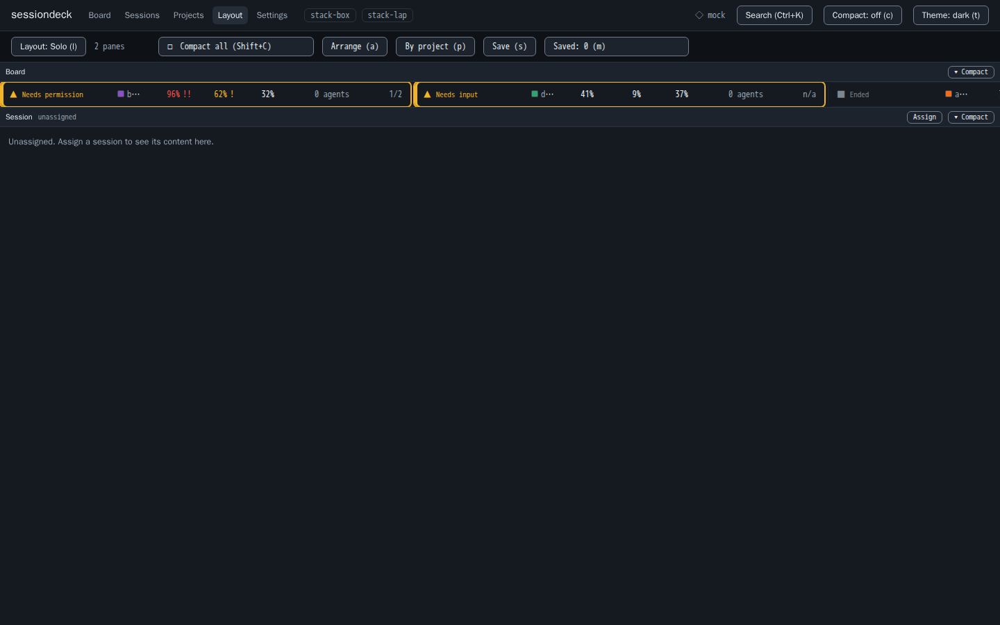
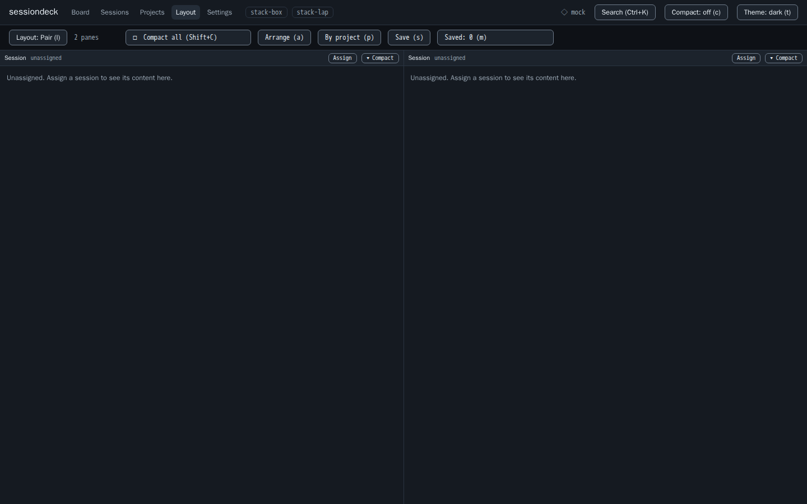
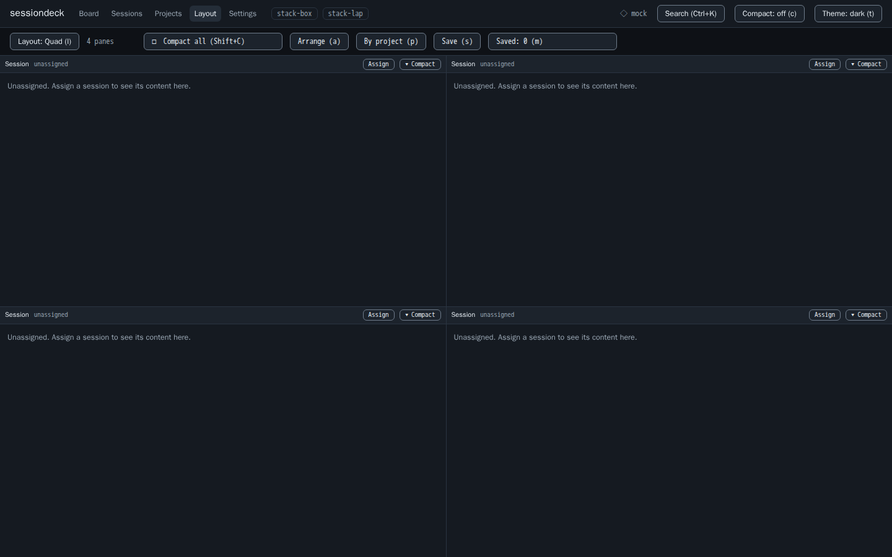
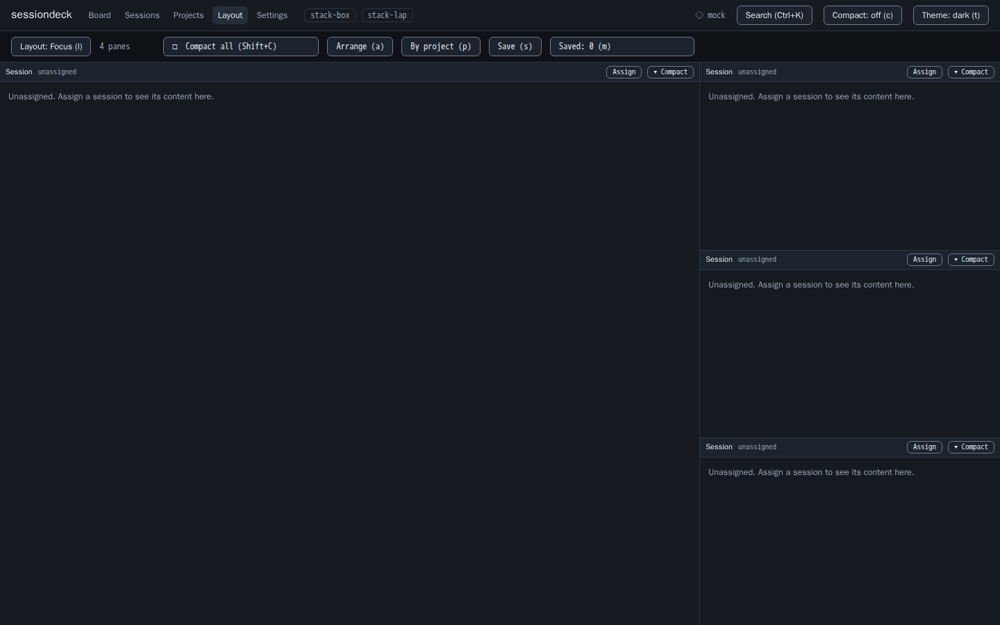
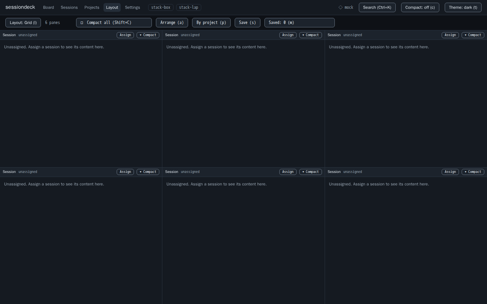
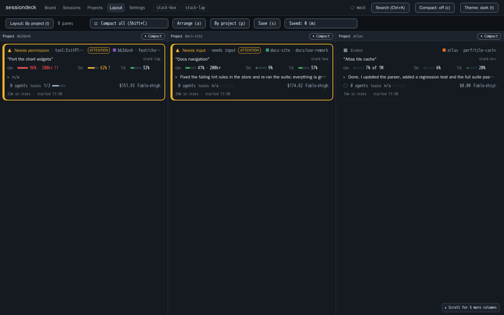
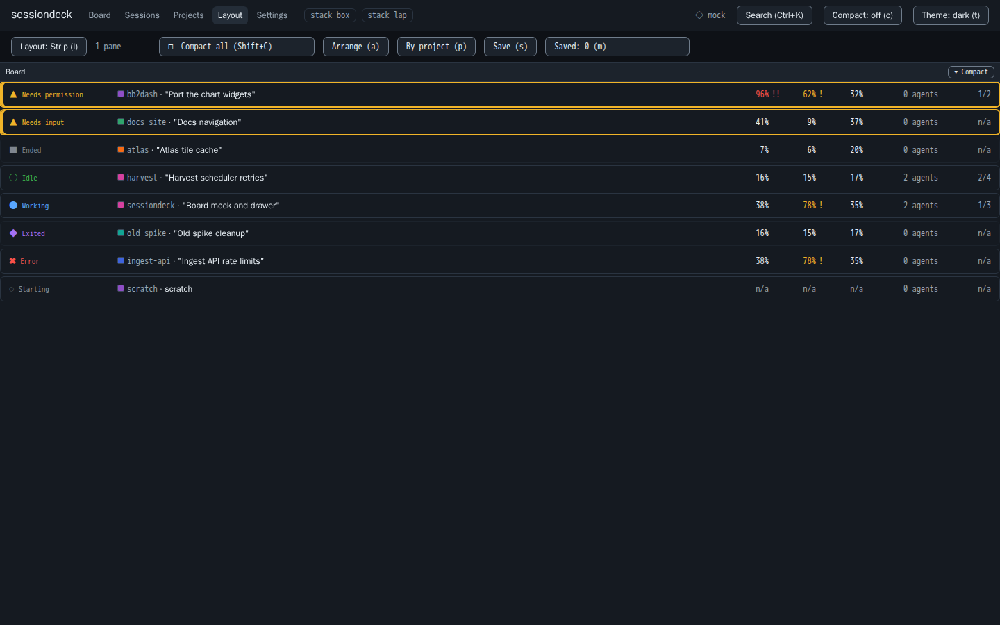

# Layouts (Phase 6)

User reference first, developer reference after. Requirements: R6.1 to R6.6. Code: `packages/web/src/layout/`, `packages/web/src/store/layout.ts`, `packages/web/src/components/layout/`, `packages/web/src/routes/Layout.tsx`; hub side `packages/hub/src/routes/layouts.ts` and `packages/hub/src/db/layouts.ts`.

Open it from the header link "Layout" (route `/layout`).

## Presets (R6.1)

| Name | Shape | Panes |
|------|-------|-------|
| solo | one session pane over a thin board strip (strip gets 7% of the height, 64 px floor) | session, board |
| pair | two side by side | 2 session |
| quad | 2 by 2 | 4 session |
| focus | one large (70%) and three small stacked (30%) | 4 session |
| grid6 | 2 rows by 3 columns | 6 session |
| by-project | a column per project, in attention order, at most 12 columns (the route shows "+N more") | project |
| strip | compact board only | board |

Panes are resizable (react-resizable-panels, MIT). Ratios live in the layout spec; the last layout is remembered per viewer in browser storage.

### Gallery

Captured at 1440x900 in the dark theme against the mock hub (fixture data only). The 2560x1440 versions are produced by `e2e/R6.1.spec.ts`.

**solo**: One session pane over a thin board strip.



**pair**: Two session panes side by side.



**quad**: Four session panes in a 2 by 2 grid.



**focus**: One large session pane with three small ones stacked beside it.



**grid6**: Six session panes, 2 rows by 3 columns.



**by-project**: One column per project, in attention order.



**strip**: Compact board only.



## Pane kinds

`board` (compact session rows), `session` (live activity list for one session, virtualized), `project` (the sessions of one project), `metrics`. A session pane with no session shows an empty slot with a hint for `Enter`.

## Auto-fit (R6.2)

Key `a` arranges the live sessions. Live means state is not `ended` and not `exited`. Sessions are assigned in attention order (needs permission or input first).

| Live sessions | Preset | Note |
|---------------|--------|------|
| 0 | strip | |
| 1 | solo | |
| 2 | pair | |
| 3 | focus | the 4th pane stays unassigned |
| 4 | quad | |
| 5 | grid6 | the 6th pane stays unassigned |
| 6 | grid6 | |
| 7 or more | grid6 | first 6 shown, "+N more" shown for the rest |

Key `p` arranges by project (by-project preset).

## Keys

| Key | Action |
|-----|--------|
| `1` to `9` | switch to the saved layout in that slot (scope below) |
| `l` | open or close the layout presets menu |
| `s` | save the current layout (same as the Save button) |
| `m` | open the saved layouts manager (same as the Saved: N button) |
| `Shift+C` | compact all panes; press again to restore the previous layout exactly |
| `a` | auto-fit by live session count |
| `p` | arrange by project |
| `Enter` or `g` | on a focused session pane, open the session picker (Arrow keys, Home, End, Enter, Escape) |
| `Delete` or `Backspace` | on a focused session pane, unassign its session |
| drag | drag a session onto a pane to assign it; dropping on an occupied pane swaps the two |

Every mouse action has a key. The layout menu supports Arrow keys, Home, End, Escape.

### Shift+C rules (R6.5)

- Pressing it snapshots the layout; pressing again restores it byte for byte.
- Switching to another layout discards the snapshot.
- Manually expanding one pane, or resizing, while compacted keeps the snapshot (restore still wins).
- The snapshot survives a reload.
- Saving while compacted saves the pre-compact layout.

## Saved layouts and host pins (R6.3)

Save with `s` or the Save button, and manage with `m`: name, slot 1 to 9 (optional), pin to host (optional). Rows live in the hub, so every viewer and browser sees them. Builtin presets are read-only and never hold a slot.

- Hotkey scope is per host pin. A layout pinned to host H answers its slot only for a viewer whose host is H. An unpinned layout answers everywhere. When both hold the same slot, the pinned one wins on its host. The hub reports the winner as `active_hotkey` on GET and PUT rows.
- Viewer host: an explicit value in Settings ("Viewer host"). Default is none, so only unpinned layouts answer 1 to 9. It is stored in the browser, never inferred from session activity.
- Switching by hotkey takes under 100 ms (measured max 48 ms against the live hub, 31 to 64 ms against the fake hub).
- Every spec change goes through one choke point that dedupes session panes (first holder in reading order wins), including rows loaded from the hub, browser storage, and the compact snapshot.

## Hub API

All routes need the bearer token (same as the rest of the hub).

| Route | Purpose |
|-------|---------|
| `GET /layouts?host=<h>` | list layouts; with `host`, `active_hotkey` is true for the row whose slot opens on that host |
| `PUT /layouts/:id` | create or replace one layout (spec, name, slot, pin) |
| `DELETE /layouts/:id` | delete one; builtin rows are refused (403 `builtin_readonly`) |

Limits (hub): spec is opaque JSON up to 32 KiB and depth 16; at most 200 rows; writes are rate limited per principal (2 per second, burst 10; over the limit gives HTTP 429). Hitting the 200-row cap gives 409 `layout_limit`; a slot clash on a reserved slot gives 409 `slot_reserved`. The web validates every row more strictly on read (depth 6, 16 panes, 2 to 12 children per split), so a row the hub accepts but the web rejects is skipped, not shown.

### CORS

The web app (port 5173) calls the hub (port 8787) from the browser, so the hub must send CORS headers. Set `HUB_ALLOWED_ORIGINS` to the web origin(s), comma separated, for example `http://localhost:5173,http://127.0.0.1:5173` (the compose file does this) or `https://deck.example.com` behind Cloudflare. Empty disables CORS, and browser calls to `/layouts` then fail. `/ingest` is never CORS-enabled. `/stream` is a WebSocket upgrade, gated by the Origin allow-list and bearer auth, not by CORS. Details: `docs/HUB.md`.

## Performance gate (R6.4)

Six content panes at 20 deltas per second must show no dropped frames in a Chromium trace. The measurement is defined in the header comment of `packages/web/e2e/R6.4.spec.ts`. It is timing sensitive and must run on a quiet host (no other containers, builds, or test runs; check the load average first). A run on a busy host is a diagnostic, not the gate.

```
pnpm --filter web exec playwright test e2e/R6.4.spec.ts
```

## Tests and evidence

Unit: `packages/web/src/layout/*.test.ts`, `store/layout.test.ts`. End to end: `packages/web/e2e/R6.1.spec.ts` (seven presets at 1440x900 and 2560x1440), `R6.2` (auto-fit per count), `R6.3` (save, load, hotkeys; fake hub and live hub), `R6.5`, `R6.6`, `R6.4` (gate). Screenshots go to `SCREENS_DIR`.
