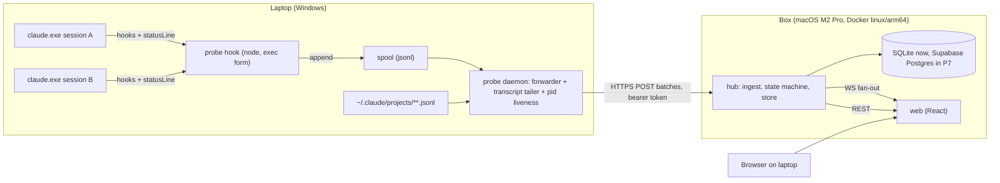

# System architecture

## 1. What this is, reduced to its parts

Four irreducible pieces. Everything else is a phase that adds to one of them.

| Piece | Lives on | One sentence |
|-------|----------|--------------|
| probe | laptop | Turns Claude Code's hook and statusLine callbacks into a stream of small JSON events, and tails transcripts, without ever slowing Claude down. |
| hub | box (laptop until Phase 7, the last stage) | Receives events, derives session state, stores history, serves a REST API and a WebSocket fan-out. |
| web | box, viewed in browser | Renders the board (metrics, states, alerts), the content view, navigation, and layouts. |
| contract | shared package | The event envelope, state machine, and wire types. Both sides import it; it is the only thing that has to be right before probe and hub can be built in parallel. |

Later additions: runner (laptop, Phase 8, hosts sessions), infra (box, Phase 7, Docker + Cloudflare + Postgres), electron (Phase 8, optional shell).



Why a daemon on the laptop instead of `type: "http"` hooks straight to the box: HTTP hooks are synchronous, have no `async` flag, `SessionStart` cannot be an HTTP hook, `SessionEnd` hooks share a 1.5 s budget, and a connection failure is silently dropped with no replay (Claude Code hooks docs, "HTTP hook fields"). A black-holed route to the box would stall every tool call until the timeout. The spool + forwarder pattern means a hook never waits on the network and nothing is lost when the box is unreachable.

## 2. Data sources, and what each one is the only source of

| Source | Cadence | Only source of | Reliability |
|--------|---------|----------------|-------------|
| Hooks (`type: "command"`, exec form) | per event, sub-second | state transitions (working, waiting on permission, idle, error), subagent start/stop with `agent_id`, task created/completed, compaction, session end reason, `last_assistant_message` on Stop | documented; payload fields per event are version-gated, Phase 0 captures fixtures |
| statusLine stdin JSON | on each assistant message, /compact, permission-mode change, `refreshInterval` tick; 300 ms debounce | `context_window.used_percentage`, `cost.total_cost_usd`, `rate_limits.five_hour` and `seven_day` (Pro/Max only, after first API response), `prompt_cache`, model, effort | documented; runs through Git Bash or PowerShell on Windows, no exec form |
| subagentStatusLine stdin JSON | per refresh tick | per-subagent `tokenCount`, `contextWindowSize`, `model` for rows visible in the agent panel | documented, visible rows only |
| Transcript JSONL | file growth | the conversation itself (content view), per-message usage, `isSidechain`, `parentUuid` branches | undocumented format, "can break on any release"; treated as content-only, never as the source of a metric that statusLine provides |
| `~/.claude/sessions/*.json` | on change | pid, `status: "busy"`, `procStart` for liveness | undocumented; used by claudecodeui, cheap second opinion on liveness |
| `claude agents --json` | on demand | pid, status, cwd, sessionId for live sessions | research preview |
| OpenTelemetry | 60 s metrics, 5 s logs | nothing unique for the board | not used in MVP; optional sink in Phase 7 for history |

Rule: a metric comes from the first documented source that has it. Transcripts are for content. If the statusLine schema changes, one adapter in `contract` changes.

## 3. The contract (packages/contract)

### 3.1 Event envelope

Every message from probe to hub is one envelope. Modeled on agents-observe (`app/server/src/types.ts`, MIT) and disler's observability server (design only, no license), with `host` added for the two-machine case.

```ts
// packages/contract/src/envelope.ts
export type EventKind =
  | 'hook'        // raw Claude Code hook payload
  | 'statusline'  // raw statusLine stdin JSON
  | 'subagents'   // raw subagentStatusLine stdin JSON
  | 'transcript'  // one or more JSONL lines from a transcript tail
  | 'liveness'    // pid alive/dead report from the daemon
  | 'probe';      // probe lifecycle: started, stopped, spool stats

export interface Envelope<K extends EventKind = EventKind> {
  v: 1;                       // envelope schema version
  id: string;                 // ulid, assigned by the probe hook at write time
  kind: K;
  host: string;               // machine name, e.g. "stack-laptop"
  os: 'win32' | 'linux' | 'darwin';
  session_id: string | null;  // null only for kind 'probe'
  agent_id?: string;          // present when the hook ran inside a subagent
  hook_event_name?: string;   // for kind 'hook'
  ts: number;                 // epoch ms at the probe
  seq: number;                // monotonically increasing per host; hub orders by (host, seq)
  payload: unknown;           // the raw stdin JSON, untouched
}
```

The payload is never reshaped on the laptop. The hub owns interpretation, so a Claude Code schema change is fixed in one place and the spool stays replayable.

### 3.2 Session state machine

Derived in the hub from hook events. The enum merges ccmonitor's file-per-session model (`internal/session/session.go`, MIT) with ccmon's event mapping (`src/status-writer.ts`, MIT), which is the better of the two because it uses `PermissionRequest` (fires at prompt time) instead of waiting ~6 s for `Notification: permission_prompt`.

```ts
// packages/contract/src/state.ts
export type SessionState =
  | 'starting'            // SessionStart
  | 'working'             // UserPromptSubmit, PreToolUse, PostToolUse, PostCompact
  | 'waiting_permission'  // PermissionRequest; Notification permission_prompt or elicitation_dialog as late fallback
  | 'waiting_input'       // Stop whose last tool was AskUserQuestion or ExitPlanMode (cctop's idle:needs_input / idle:awaiting_plan)
  | 'idle'                // Stop
  | 'error'               // StopFailure (API errors arrive as StopFailure)
  | 'ended'               // SessionEnd, with reason
  | 'exited';             // pid gone without SessionEnd (crash, window closed)

export function reduce(prev: SessionSnapshot, e: Envelope<'hook'>): SessionSnapshot
```

Verbatim reference, ccmon `src/status-writer.ts` (https://github.com/appaquet/ccmon/blob/main/src/status-writer.ts):

```ts
export function mapHookEventToState(hookEvent: string): SessionState | null {
  switch (hookEvent) {
    case "UserPromptSubmit":
      return "running";
    case "PostToolUse":
      return "running";
    case "PermissionRequest":
      return "waiting_for_permission";
    case "Stop":
      return "stopped";
    case "StopFailure":
      return "error";
    case "SessionEnd":
      return "closed";
    default:
      return null;
  }
}
```

and ccmon's insurance rule, which we keep: on `Notification` with `permission_prompt`, write a synthetic `PermissionRequest` unless the state is already `waiting_permission` ("insurance for sub-agents where the PermissionRequest hook may not fire").

Verbatim reference, cctop `plugin/scripts/cctop-hook.sh` (https://github.com/DeanLa/cctop/blob/main/plugin/scripts/cctop-hook.sh), for the Stop sub-states:

```bash
    Stop)
        # Idle sub-status based on last tool before Stop
        case "$LAST_TOOL" in
            ExitPlanMode)     STATUS="idle:awaiting_plan" ;;
            AskUserQuestion)  STATUS="idle:needs_input" ;;
            *)                STATUS="idle" ;;
        esac
```

Two ccmonitor behaviors to port (`internal/hook/hook.go`, https://github.com/martinwickman/ccmonitor/blob/main/internal/hook/hook.go): `cleanupSamePID` (a `/clear` or `--resume` creates a new `session_id` under the same pid without a `SessionEnd` for the old one) and `findParentPID` (walk up past shell processes to find the Claude pid, because on Windows the chain is `claude → bash → bash → bash → hook`):

```go
func findParentPID() int {
	pid := os.Getppid()
	if pid <= 0 {
		return 0
	}
	for range 20 { // safety limit
		proc, err := ps.FindProcess(pid)
		if err != nil || proc == nil {
			return 0
		}
		if !isShellProcess(proc.Executable()) {
			return pid
		}
		ppid := proc.PPid()
		if ppid <= 0 || ppid == pid {
			return pid // can't go higher, return what we have
		}
		pid = ppid
	}
	return pid
}
```

### 3.3 Session snapshot (what the board renders)

```ts
export interface SessionSnapshot {
  session_id: string; host: string; cwd: string; project_dir: string | null;
  session_name: string | null; model: { id: string; display_name: string } | null;
  effort: string | null; state: SessionState; state_since: number; state_detail: string | null; // "tool:Bash", "needs input"
  started_at: number; last_event_at: number; ended_reason: string | null; pid: number | null;
  context: { used_pct: number | null; window: number | null; input: number | null; output: number | null } ;
  rate_limits: { five_hour: Window | null; seven_day: Window | null; captured_at: number | null };
  cost: { usd: number | null; duration_ms: number | null; lines_added: number | null; lines_removed: number | null };
  subagents: Array<{ agent_id: string; agent_type: string; started_at: number; ended_at: number | null; tokens: number | null; context_window: number | null; model: string | null }>;
  tasks: { total: number; completed: number; last_subject: string | null };
  git: { branch: string | null; worktree: string | null; pr: { number: number; url: string } | null };
  last_assistant_message: string | null; last_prompt: string | null;
  prompt_cache: { warm: boolean; expires_at: number | null } | null;
  compactions: number;
}
```

`Window = { used_pct: number | null; resets_at: number | null }`. Guard from Claude-Code-Usage-Monitor `src/claude_monitor/output/official.py` (MIT): at or past `resets_at` the captured percentage is stale and becomes null; and the known leak bug (#52326) where `used_percentage` carries the `resets_at` epoch is filtered by range check (0..100).

### 3.4 Wire protocol

- `POST /ingest` body `{ host, envelopes: Envelope[] }`, header `Authorization: Bearer <probe token>`; response `{ accepted: number, last_seq: number }`. Idempotent on `id`; the hub dedups with agents-observe's 5 s bucket signature as a second line (`app/server/src/utils/event-signature.ts`).
- `GET /sessions?live=1`, `GET /sessions/:id`, `GET /sessions/:id/events?after=<seq>`, `GET /sessions/:id/transcript?after=<line>`, `GET /projects`, `GET /hosts`.
- `WS /stream`: on open `{type:'initial', sessions: SessionSnapshot[]}`; then `{type:'session', data: SessionSnapshot}` deltas, `{type:'transcript', session_id, lines: NormalizedEntry[]}`, `{type:'alert', ...}`. Heartbeat ping every 25 s.

Verbatim reference for the fan-out, claude-watch `src/server/websocket.ts` (MIT, https://github.com/NirDiamant/claude-watch/blob/main/src/server/websocket.ts):

```ts
export function broadcast(message: WebSocketMessage) {
  if (!wss) return;
  const data = JSON.stringify(message);
  wss.clients.forEach((client) => {
    if (client.readyState === WebSocket.OPEN) {
      client.send(data);
    }
  });
}
```

### 3.5 Normalized transcript entry (content view)

Target schema borrowed from vibe-kanban's `NormalizedEntryType` (Apache-2.0, attribution in NOTICE; `crates/executors/src/logs/mod.rs`) and Crystal's `UnifiedMessage` (MIT, `frontend/src/components/panels/ai/transformers/MessageTransformer.ts`):

```ts
export interface UnifiedMessage {
  id: string;
  role: 'user' | 'assistant' | 'system';
  timestamp: string;
  segments: MessageSegment[];
  metadata?: { agent?: string; model?: string; duration?: number; tokens?: number; cost?: number; systemSubtype?: string; [key: string]: unknown };
}
export type MessageSegment =
  | { type: 'text'; content: string }
  | { type: 'tool_call'; tool: ToolCall }
  | { type: 'tool_result'; result: ToolResult & { toolCallId: string } }
  | { type: 'system_info'; info: SystemInfoData }
  | { type: 'thinking'; content: string }
  | { type: 'diff'; diff: string }
  | { type: 'error'; error: { message: string; details?: string } };
```

Crystal's `ClaudeMessageTransformer.transform()` does two passes: build `toolResults: Map<tool_use_id, ToolResult>` and a `parentToolMap` from `parent_tool_use_id`, then turn assistant content blocks into segments. It consumes stream-json rows, which are the same shape as transcript JSONL rows, so it ports directly.

## 4. probe (packages/probe)

Two executables from one package.

### 4.1 `probe-hook` (short-lived, per event)

Registered in `~/.claude/settings.json` in exec form so it runs without a shell and without the `.cmd` shim problem on Windows:

```json
{
  "hooks": {
    "PreToolUse": [{ "matcher": "", "hooks": [{ "type": "command", "command": "node", "args": ["C:/Users/stack/sessiondeck/packages/probe/dist/hook.mjs"], "timeout": 5 }] }]
  },
  "statusLine": { "type": "command", "command": "node C:/Users/stack/sessiondeck/packages/probe/dist/statusline.mjs", "refreshInterval": 5 }
}
```

Events registered: SessionStart, UserPromptSubmit, PreToolUse, PostToolUse, PostToolUseFailure, PermissionRequest, PermissionDenied, Notification, SubagentStart, SubagentStop, TaskCreated, TaskCompleted, Stop, StopFailure, PreCompact, PostCompact, SessionEnd. (cctop registers 22; the rest add nothing to the board.)

Behavior: read stdin, wrap in an envelope, append one line to `%LOCALAPPDATA%\sessiondeck\spool\<yyyy-mm-dd>.jsonl` with an advisory lock, record `ppid`-derived Claude pid on SessionStart, exit 0. Always exit 0, never print to stdout (stdout starting with `{` is parsed as hook JSON output). Target < 80 ms wall including Node startup; measured in Phase 1.

The statusLine variant does the same append and then prints a one-line status (so the built-in status line still works). Pattern from Claude-Code-Usage-Monitor: write-then-render, never throw ("a crash here would blank the user's status bar").

Fast-exit reference (agents-observe `hooks/scripts/hook.sh`, MIT), the latency trick the Node version mirrors by doing only a file append:

```bash
#!/bin/bash
# Fast hook wrapper — reads stdin, backgrounds the node CLI, exits immediately.
# Claude Code hooks block until the command exits. By backgrounding node and
# redirecting all file descriptors, bash exits in ~2-5ms instead of ~50-100ms.

SCRIPT_DIR="$(cd "$(dirname "$0")" && pwd)"
input=$(cat)
echo "$input" | node "$SCRIPT_DIR/observe_cli.mjs" hook > /dev/null 2>&1 &
exit 0
```

### 4.2 `probe-daemon` (long-lived, one per machine)

- Tails the spool by byte offset, batches up to 200 envelopes or 250 ms, POSTs to the hub with exponential backoff; cursor persisted so restarts never duplicate or drop.
- Transcript tailer: for every live session (known from SessionStart envelopes), tail `transcript_path` by byte offset. Verbatim reference, cctop `plugin/scripts/cctop-poller.py` (MIT), including the compaction/inode reset:

```python
    # File was atomically replaced (compaction) — reset offset
    if prev_inode and current_inode != prev_inode:
        offset = 0

    if size <= offset:
        if size < offset:
            offset = 0  # file shrank — reset
        else:
            return [], offset, current_inode
```

  On Windows there is no inode; use `(ctime, size < offset)` as the replace signal. Subagent transcripts live at `<project>/<session>/subagents/agent-<id>.jsonl` and are tailed when `SubagentStart` arrives.
- Liveness: every 10 s `process.kill(pid, 0)` per known pid; dead pid without SessionEnd emits a `liveness` envelope so the hub can mark `exited`. Second opinion from `~/.claude/sessions/*.json` (claudecodeui `claude-cli-liveness.service.ts`, AGPL, used as a spec, not copied):

```ts
  const providerSessionId = typeof record.sessionId === 'string' ? record.sessionId : '';
  const pid = typeof record.pid === 'number' ? record.pid : NaN;
  if (!providerSessionId || !Number.isInteger(pid) || pid <= 0 || record.status !== 'busy') {
    return null;
  }
```

- Runs as a Windows scheduled task or a tray-less background process started at login (`pm2`, `nssm`, or Task Scheduler; decided in Phase 1).

## 5. hub (packages/hub)

Node 22, Fastify (or Express; Fastify for schema validation of the envelope), `ws`, better-sqlite3. Single process, stateless apart from the DB, so it containerizes trivially.

### 5.1 Storage schema (SQLite now, Supabase Postgres in Phase 7, ADR 0006)

```sql
CREATE TABLE hosts (host TEXT PRIMARY KEY, os TEXT, last_seen INTEGER, last_seq INTEGER);
CREATE TABLE events (
  id TEXT PRIMARY KEY, host TEXT NOT NULL, seq INTEGER NOT NULL, kind TEXT NOT NULL,
  session_id TEXT, agent_id TEXT, hook_event_name TEXT, ts INTEGER NOT NULL,
  payload TEXT NOT NULL, signature TEXT, UNIQUE(host, seq));
CREATE INDEX events_session_ts ON events(session_id, ts);
CREATE TABLE sessions (session_id TEXT PRIMARY KEY, host TEXT, snapshot TEXT NOT NULL, state TEXT, project_dir TEXT, started_at INTEGER, last_event_at INTEGER, ended_at INTEGER);
CREATE TABLE transcript_lines (session_id TEXT, agent_id TEXT, line_no INTEGER, ts INTEGER, raw TEXT, PRIMARY KEY(session_id, agent_id, line_no));
CREATE TABLE statusline_samples (session_id TEXT, ts INTEGER, context_used_pct REAL, cost_usd REAL, five_hour_pct REAL, five_hour_resets INTEGER, seven_day_pct REAL, seven_day_resets INTEGER, PRIMARY KEY(session_id, ts));
CREATE TABLE projects (project_dir TEXT PRIMARY KEY, name TEXT, color TEXT, vault_collection TEXT);
CREATE TABLE layouts (id TEXT PRIMARY KEY, name TEXT, spec TEXT, builtin INTEGER DEFAULT 0);
```

Snapshots are materialized (reduced on ingest, stored as JSON) so the board never replays events to render. Replay from `events` is the recovery path.

### 5.2 Ingest pipeline

`POST /ingest` → validate envelope (zod, shared with contract) → dedup on `id` and signature → insert → for `hook` kinds run `reduce()` → for `statusline` kinds update context/cost/rate_limits and append a sample → for `transcript` kinds normalize and append → broadcast delta. One transaction per batch.

Signature reference, agents-observe `app/server/src/utils/event-signature.ts` (MIT):

```ts
const BUCKET_MS = 5000
export function computeEventSignature(envelope, timestamp: number): string {
  const material = {
    session_id: envelope.sessionId, agent_id: envelope.agentId, hook_name: envelope.hookName,
    cwd: envelope.cwd ?? null, payload: envelope.payload, _meta: envelope._meta ?? null,
    flags: envelope.flags ?? null, ts_bucket: Math.floor(timestamp / BUCKET_MS),
  }
  return createHash('sha256').update(canonicalJson(material)).digest('hex')
}
```

### 5.3 Context percentage from transcripts (fallback only)

If statusLine is absent for a session, the hub computes context from the newest non-sidechain assistant row. claudecodeui's rule (AGPL, spec only) is the right one: skip `isSidechain` rows (subagent turns report the subagent's window) and skip all-zero `<synthetic>` usage blocks.

### 5.4 History aggregation

Cost and token history per session and per day come from transcript usage rows with ccusage v19.0.3's dedup (MIT, `apps/ccusage/src/adapter/claude/data-loader.ts`): key on `message.id` plus `requestId`, and when a streaming row repeats a `message.id`, keep the row with the larger token total.

```ts
export function createUniqueHash(data: UsageData): string | null {
	const messageId = data.message.id;
	if (messageId == null) {
		return null;
	}
	const requestId = data.requestId;
	return requestId == null ? messageId : `${messageId}:${requestId}`;
}
```

Pricing: LiteLLM `model_prices_and_context_window.json` fetched at startup and cached (ccusage `packages/internal/src/pricing.ts` approach). Live cost on the board always prefers statusLine `cost.total_cost_usd`.

## 6. web (packages/web)

React 18 + Vite + TypeScript + Tailwind + Zustand. One WebSocket client with reconnect and `initial` resync. Routes: `/board` (Phase 3), `/session/:id` (Phase 4), `/projects` and `/archive` (Phase 5), `/layouts` (Phase 6), `/settings`. Component anatomy and tokens are in `03-design-system.md`.

Content renderer: port Crystal's `panels/ai/components/{ToolCallView,ToolCallGroup,MessageSegment,TodoListDisplay}.tsx` and `transformers/ClaudeMessageTransformer.ts` (MIT). claudecodeui's `src/modules/chat/tools/configs/toolConfigs.ts` (AGPL) is the most complete per-tool rendering table and is used as a checklist of which tools need custom renderers (Edit diff, Bash output, Read excerpt, Agent/subagent nesting, TodoWrite/TaskCreate snapshots), not copied.

## 7. Security model

MVP (LAN): hub binds to the LAN interface, probe → hub uses a static bearer token stored in the probe's config file (not in `settings.json`, which is readable by any session). Browser → hub: same token entered once, stored in localStorage. No TLS on LAN in MVP; the box phase adds it.

Phase 7 (box, remote): Cloudflare Tunnel from the box (no inbound ports), Cloudflare Access in front of the web origin (your identity provider), a separate Access service token for the probe's `/ingest` path. Hub still checks its own bearer token (defense in depth). Transcripts contain source and sometimes secrets; the probe redacts lines matching `.env`-style `KEY=value` patterns and known token prefixes before shipping (Phase 4 requirement), and the hub never exposes raw payloads without auth.

Order (ADR 0010): Phase 8 ships before Phase 7, so the runner is first gated with the hub on the laptop (localhost bind, hub bearer token, runner channel authentication). Phase 7 re-runs the runner security review with the hub reachable through Access before harbor merges (R7.10).

Threat you should write up for yourself: the probe token in a config file on the laptop, the hub being a write path for anything that holds the token, and the fact that a compromised session (prompt injection in a repo) could run `curl` against the hub from inside a Bash tool call. Mitigation: ingest only accepts the envelope schema, rate limits per host, and nothing on the hub executes anything.

## 8. Repo layout

```
sessiondeck/
  packages/contract/   zod schemas, state machine reducer, types; 100% unit-tested, no deps beyond zod
  packages/probe/      hook.mjs, statusline.mjs, daemon; esbuild bundles to dist/*.mjs; tests run on windows-latest too
  packages/hub/        fastify server, ingest, store, ws, migrations
  packages/web/        vite react app
  infra/               docker-compose.yml (hub+web), cloudflared config (P7), postgres (P7)
  docs/planning/       copy of this set
  .claude/agents/      sd-*.md (see agents/)
  .github/workflows/   ci.yml
```

pnpm workspaces, TypeScript strict, ESLint + Prettier, Vitest everywhere, Playwright for web in Phase 3+.

## 9. Borrow map

| Need | Borrow from | License | How |
|------|-------------|---------|-----|
| hook event → state | ccmon `src/status-writer.ts`, cctop `cctop-hook.sh` | MIT | copy logic into `contract/state.ts` with attribution |
| pid discovery, same-pid cleanup, cross-OS liveness | ccmonitor `internal/hook/hook.go`, `internal/session/session.go` | MIT (confirm LICENSE file in repo; clone lacked it) | port Go → TS |
| spool-and-forward, fire-and-forget | agents-observe `hooks/scripts/hook.sh`, `hooks/scripts/lib/http.mjs` | MIT | copy pattern |
| transcript byte-offset tailing with compaction reset | cctop `cctop-poller.py` | MIT | port Python → TS |
| statusLine payload types | ccstatusline `src/types/StatusJSON.ts` | MIT | copy zod schema; note undocumented `seven_day_sonnet`/`seven_day_opus` windows it has seen |
| rate-limit staleness guard | Claude-Code-Usage-Monitor `output/official.py` | MIT | port |
| JSONL dedup, pricing, 5h block heuristic | ccusage tag v19.0.3 (last TS; v20 is Rust) | MIT | copy modules |
| event signature dedup, all-events hooks.json | agents-observe | MIT | copy |
| WS broadcast, event ingest route shape | claude-watch | MIT | copy |
| message transformer, tool call views, panel layout | Crystal (archived Feb 2026) | MIT | copy components, modernize |
| normalized entry schema | vibe-kanban `logs/mod.rs` | Apache-2.0 | adopt shape, add NOTICE |
| session watcher, liveness, token summary, tool render table, subagent panel | claudecodeui (CloudCLI) | AGPL-3.0 | read as spec only; no code copied, keeps the repo MIT-cleanable |
| hook server design | disler observability | none | design only |

## 10. Known limits you will hit

- `rate_limits` appear only after the first API response and only on Pro/Max; windows are dropped once `resets_at` passes, so the board shows "n/a" at session start and after a reset until the next statusLine tick.
- statusLine runs through Git Bash or PowerShell on Windows; backslashes in the command are eaten, use forward slashes.
- `PermissionRequest` may not fire inside subagents; the `Notification` fallback is ~6 s late.
- Agent teams (`CLAUDE_CODE_EXPERIMENTAL_AGENT_TEAMS`) write `~/.claude/teams/` and `~/.claude/tasks/<team>/`; not in scope until you use them.
- The transcript format is explicitly unstable. Every normalizer has a fixture suite captured from your real sessions (Phase 0) and a "render as raw JSON" fallback so an unknown row never blanks the view.
- `CLAUDE_SESSION_ID` as an env var in hook commands appears in community docs (cctop `reference/session-data-files.md`) but is not in the official env var list; the probe uses `session_id` from stdin, never the env var.
