# Phased roadmap

Nine phases. Each has a doc in `phases/` with MVP, Scope, Blockers/Constraints, Inputs, Instruments, Requirements, Definition of Done. Requirement IDs are `R<phase>.<n>` so a test, a PR, or a review finding can name exactly what it covers.

| Phase | Name | Delivers | Depends on | Parallel with |
|-------|------|----------|------------|---------------|
| 0 | Contract and scaffold | Monorepo, CI, `contract` package with envelope + state machine + fixtures captured from your real sessions, sprint container tooling | nothing | nothing (gate for everything) |
| 1 | Probe | Laptop hook + statusLine + daemon (spool, forward, tail, liveness), installer for `settings.json` | 0 | 2, 3 |
| 2 | Hub | Ingest, store, reducer, REST, WS, Docker on laptop | 0 | 1, 3 |
| 3 | Board | Web MVP: live session cards with the indicator set, detail drawer, alerts, compact mode | 0 (mocks), 2 (live) | 1, 2 |
| 4 | Content | Session view: normalized conversation, tool calls, diffs, files touched, subagent threads | 1 (tailer), 2, 3 | 5, 6, 8 |
| 5 | Atlas | Projects, phases, grouping, search, archive importer for vault session captures | 3 | 4, 6, 8 |
| 6 | Layouts | Preset grids by session count and project split, saved layouts, compact board | 3 | 4, 5, 8 |
| 7 | Harbor | Move hub+web to the box: Docker, Supabase Postgres, Cloudflare Tunnel + Access, backups, hardening | 2, 4, 5, 6, 8 | nothing (last) |
| 8 | Cockpit | Launch and host sessions from the app: laptop runner (SDK + node-pty), terminal pane, handoff-prompt launcher; optional Electron shell | 2, 3 | 4 |

```mermaid
gantt
  title sessiondeck lanes (relative order, not dates)
  dateFormat X
  axisFormat %s
  section Gate
  P0 Contract and scaffold :p0, 0, 2
  section Lane A laptop
  P1 Probe :p1, after p0, 3
  P4 Content (tailer side) :p4a, after p1, 1
  section Lane B hub
  P2 Hub :p2, after p0, 3
  section Lane C web
  P3 Board (mocks then live) :p3, after p0, 3
  P4 Content (viewer) :p4, after p3, 3
  P5 Atlas :p5, after p3, 2
  P6 Layouts :p6, after p3, 2
  section Last
  P8 Cockpit :p8, after p5 p6, 4
  P7 Harbor :p7, after p8 p4, 3
```

## Why this order

- Phase 0 exists so that probe, hub, and board can be built by three sessions at once without inventing three different envelopes. The contract package plus real captured fixtures is the whole gate. It is small; do not let it grow.
- Phases 1, 2, 3 are the MVP and are independent once the contract is fixed. Board starts on fixture-driven mocks and flips to the live hub when Phase 2 lands.
- Phase 4 is the first thing that needs the transcript tailer, which is why the tailer is in Phase 1 but its consumer is not.
- Phases 5 and 6 are UI-only and can run in parallel with Phase 4 and with Phase 8.
- Phase 8 runs before Phase 7 (decision 16, 2026-10-19, ADR 0010): cockpit is built and used against the hub on the laptop, bound to localhost; its security gate covers that local setup.
- Phase 7 is last on purpose: the UI and functionality work locally with real sessions first, then the whole stack ports to the macOS box (linux/arm64 containers) and gains Cloudflare Tunnel + Access, Supabase Postgres, and backups. Because the runner was gated with a local hub, Phase 7 re-runs the runner security review with the hub reachable through Access (R7.10). Until 2026-10-19 the plan ran Phase 7 beside Phases 4 to 6 and put Phase 8 last.

## MVP line

The first thing you use daily is Phases 0-3: every live session as a card with state, context %, 5h/7d, cost, subagents, tasks, and an alert when something is waiting on you. Everything after that is additive.

## Milestones

| Milestone | Means |
|-----------|-------|
| M1 "I can see them" | P0-P3 merged; board open in a browser tab on the laptop; all live sessions appear within 1 s of starting |
| M2 "I can read them" | P4 merged; click a card and read what the session did, with diffs |
| M3 "I can organize them" | P5 + P6 merged; projects, archive, and layouts |
| M4 "I can drive them" | P8 merged; launch a phase session with its handoff prompt from the app |
| M5 "It lives on the box" | P7 merged; reachable through Cloudflare Access from anywhere |
